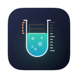
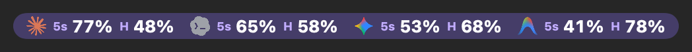
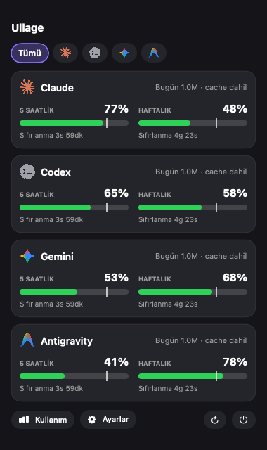
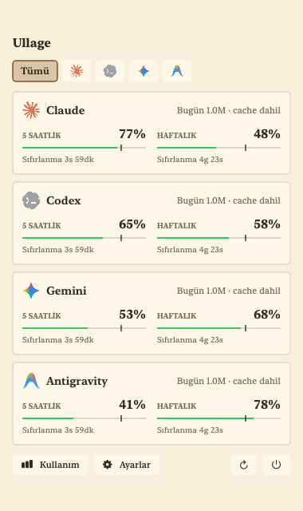
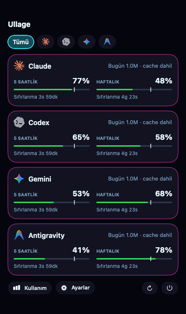
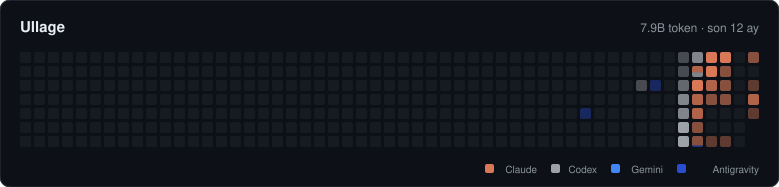

<div align="center">



# Ullage

**Know before you hit your AI limit.**
Shows how much usage you have left on Claude, Codex, Gemini and Antigravity, right in the Mac menu bar.

[](https://github.com/mertpural/ullage/releases/latest)


[](LICENSE)

[**⬇️ Download (macOS)**](https://github.com/mertpural/ullage/releases/latest/download/Ullage.zip) · [Website](https://ullage-app.netlify.app) · [Report an issue](https://github.com/mertpural/ullage/issues)

**English** · [Türkçe](README.md)



</div>

<p align="center">
  
  
  
</p>
<p align="center"><sub>Shown with sample values. There are 9 themes, all selectable in Settings. The interface is available in Turkish and English.</sub></p>

## Why Ullage?

*Ullage* is the empty space above the liquid in a tank. Ullage tells you how much of your allowance is left.

| | |
|---|---|
| 🕐 **Remaining usage at a glance** | Your 5-hour and weekly allowance in the menu bar, with the time until reset. Choose percent, bar, ring or battery. |
| 🔔 **Timely alerts** | A notification below 15% and 5%, and when the limit resets. A summary of last week every Monday morning. |
| 📈 **Will it run out?** | Tells you when the limit runs out at your current pace ("Runs out at this pace: 19:40"). |
| 📊 **Usage history** | An activity map like GitHub's contribution graph, daily and monthly token charts, your most used projects, estimated cost. Export as CSV. |
| 🧩 **Several tools** | Claude, Codex, Gemini, Antigravity. Plus OpenCode, Kimi and Cline/Roo Code token counts when they are on your Mac. |
| 🎨 **Your look** | 9 themes, Turkish and English interface. |
| 🔒 **Private** | Nothing is sent anywhere. No server, no account, no trackers. It never looks at chat content, only usage numbers. |
| 🔄 **Stays up to date** | Get a notification when a new version is out and update with one click (optional). |

## GitHub profile card

If you like, you can put your token usage map on your GitHub profile. Ullage updates one image in your own profile repo once a day. The image contains only daily token totals. Turn it on in Settings > Automation.

<p align="center"></p>

## Supported tools

| Tool | What it shows | How it is read |
|---|---|---|
| **Claude** (Claude Code and the Claude app) | Remaining 5-hour and weekly limit, tokens | `~/.claude` logs; the limit comes from Claude Code's own sign-in |
| **Codex** | Remaining 5-hour and weekly limit, tokens | `~/.codex/sessions` logs |
| **Antigravity** | Remaining limit (while the IDE is open), tokens | The app's own local server and logs |
| **Gemini** (with a Code Assist license) | Daily quota | Gemini CLI sign-in |
| **OpenCode** | Tokens only | `~/.local/share/opencode` logs |
| **Kimi CLI** | Tokens only | `~/.kimi/sessions` logs |
| **Cline / Roo Code** (VS Code, Cursor, Windsurf, VSCodium) | Tokens only | The extension's own task folders |

The first four tools are always listed. **OpenCode, Kimi and Cline only appear if they are on your computer:** if their log folder does not exist, Ullage does not show them anywhere, not even in Settings. Once you start using one, it appears on the **Providers** page. You turn it on there to show it in the menu bar and popover; they are never added automatically.

These three tools have no remaining limit to read, since they usually run on your own API key. Ullage only counts the tokens you spend; they show up in the cards, the usage page and the activity map next to the others. The log formats come from documentation and have not been tested against real installs yet; if a tool updates and changes its format, those records are skipped silently and the app is unaffected.

Other websites (ChatGPT, Perplexity, Grok and the like) are not supported because they leave no records on your computer.

## Install

### Mac (macOS 14 or later)

1. Open the zip and drag `Ullage.app` into **Applications**.
2. **Right-click the app → Open → Open** (needed the first time because the app is not notarized).
3. On first launch macOS asks for a few permissions. Allow all of them:
   - **Notifications** (to warn you when your allowance is low).
   - **Keychain** (to read the Claude Code sign-in). If it appears, choose "Always Allow".
   - **Documents folder** (may be asked while the Claude command runs).
4. On launch the app shows the **Setup check** on the Providers page; you can see there what is missing.

One line in Terminal:

```bash
curl -L https://github.com/mertpural/ullage/releases/latest/download/Ullage.zip -o /tmp/Ullage.zip \
  && unzip -q -o /tmp/Ullage.zip -d /Applications \
  && xattr -cr /Applications/Ullage.app \
  && open /Applications/Ullage.app
```

## Where do the limits come from?

| Tool | Limit | Tokens |
|---|---|---|
| Claude | The Claude Code command and Anthropic's usage information (with your Claude Code or Claude app sign-in) | `~/.claude` folder |
| Codex | `~/.codex` folder | same place |
| Antigravity | Its local server while the IDE is open | local conversation records |
| Gemini | Google quota information (with your Gemini CLI sign-in, license required) | none |

**How is Claude's limit read?** One of three ways, tried in order:
1. Claude Code's status line (if you turn it on in Notifications and automation): written to a local file after every reply, no network needed.
2. Anthropic's usage information: an unofficial address that can hit rate limits.
3. The Claude Code command: sends one tiny Haiku request and measures the limit. It only runs when there is new usage and at most every 5 minutes. No Terminal needed.

If none of them works, the last known value is shown marked "Estimated". Missing data is never made up: Settings > Providers labels each piece of data "Exact / Estimated / No data".

## If the limit does not show

- **Claude:** You need to be signed in to Claude Code or the Claude app. In Terminal you can run `claude` and type `/login`.
- **Codex:** If the logs are compressed you need `brew install zstd` (Mac).
- **Antigravity:** It is read while the IDE is open.
- **Gemini:** Install with `npm i -g @google/gemini-cli` and sign in once.
- The **Setup check** on the Providers page shows which of these is missing.

## Notes

- Claude's limit information is read in unofficial ways and may change in the future.
- The estimated cost is based on third-party price lists and is approximate; it does not show your subscription fee.
- Logos are from the [lobe-icons](https://github.com/lobehub/lobe-icons) package. Trademarks belong to their owners.
- This project is not affiliated with Anthropic, OpenAI or Google.

## License

MIT
