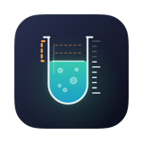
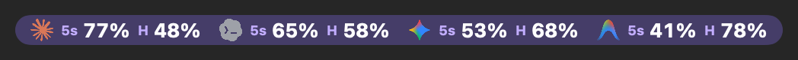
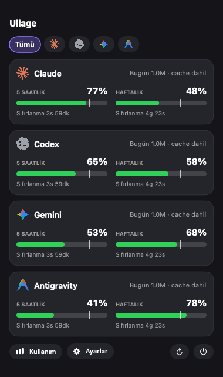
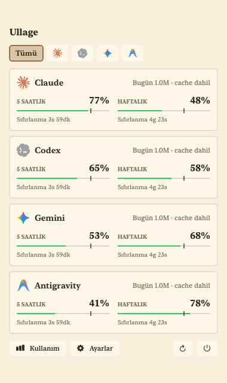
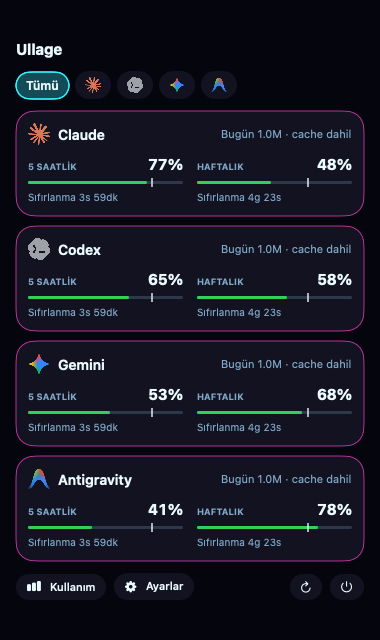
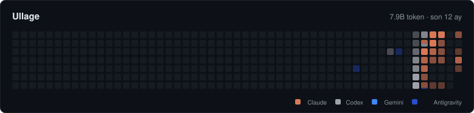

<div align="center">



# Ullage

**Yapay zekâ limitine çarpmadan önce bil.**
Mac'in üst menü çubuğunda Claude, Codex, Gemini ve Antigravity için kalan hakkını gösterir.

[](https://github.com/mertpural/ullage/releases/latest)


[](LICENSE)

[**⬇️ İndir (macOS)**](https://github.com/mertpural/ullage/releases/latest/download/Ullage.zip) · [Web sitesi](https://ullage-app.netlify.app) · [Sorun bildir](https://github.com/mertpural/ullage/issues)



</div>

<p align="center">
  
  
  
</p>
<p align="center"><sub>Örnek değerlerle gösterim. 9 tema var, hepsi ayarlardan seçilir.</sub></p>

## Neden Ullage?

*Ullage*, bir depoda sıvının üstünde kalan boşluk demek. Ullage de sana hakkının ne kadarının boş kaldığını söyler.

| | |
|---|---|
| 🕐 **Kalan limit, bir bakışta** | 5 saatlik ve haftalık kalan hakkın menü çubuğunda, ne zaman yenileneceğiyle birlikte. Yüzde, çubuk, halka ya da pil gösterimi seç. |
| 🔔 **Zamanında haber** | Hakkın %15 ve %5'in altına inince ve limit yenilenince bildirim. Pazartesi sabahı geçen haftanın özeti. |
| 📈 **Bu hızla biter mi?** | Şu tempoyla gidersen limitin ne zaman biteceğini söyler ("Bu hızla biter: 19:40"). |
| 📊 **Kullanım geçmişi** | GitHub'daki katkı tablosuna benzer etkinlik haritası, günlük ve aylık token grafikleri, en çok kullandığın projeler, tahmini maliyet. CSV olarak dışa aktarılır. |
| 🧩 **Birden çok araç** | Claude, Codex, Gemini, Antigravity. İzi varsa OpenCode, Kimi ve Cline/Roo Code token'ları da. |
| 🎨 **Senin görünümün** | 9 tema, Türkçe ve İngilizce arayüz. |
| 🔒 **Gizli** | Hiçbir veri bir yere gönderilmez. Sunucusu, hesabı, izleyicisi yok. Sohbet içeriğine bakmaz, yalnızca kullanım sayılarını okur. |
| 🔄 **Kendini güncel tutar** | Yeni sürüm çıkınca bildirim gelir, tek tıkla güncellenir (isteğe bağlı). |

## GitHub profil kartı

İstersen token kullanım haritanı GitHub profiline koyabilirsin. Ullage, kendi profil reponda bir resmi günde bir günceller. Resimde yalnızca günlük toplam token vardır. Ayarlar > Otomasyon'dan açılır.

<p align="center"></p>

## Desteklenen araçlar

| Araç | Ne gösterir | Nasıl okunur |
|---|---|---|
| **Claude** (Claude Code ve Claude uygulaması) | Kalan 5 saatlik ve haftalık limit, token | `~/.claude` kayıtları, limit için Claude Code'un kendi oturumu |
| **Codex** | Kalan 5 saatlik ve haftalık limit, token | `~/.codex/sessions` kayıtları |
| **Antigravity** | Kalan limit (IDE açıkken), token | Uygulamanın kendi yerel sunucusu ve kayıtları |
| **Gemini** (Code Assist lisansı varsa) | Günlük kota | Gemini CLI girişi |
| **OpenCode** | Yalnızca token | `~/.local/share/opencode` kayıtları |
| **Kimi CLI** | Yalnızca token | `~/.kimi/sessions` kayıtları |
| **Cline / Roo Code** (VS Code, Cursor, Windsurf, VSCodium) | Yalnızca token | Eklentinin kendi görev klasörleri |

İlk dört araç her zaman listede durur. **OpenCode, Kimi ve Cline yalnızca bilgisayarında izi varsa görünür:** kayıt klasörü yoksa Ullage onları hiç göstermez, ayarlarda da çıkmaz. Kullanmaya başlayınca kendiliğinden **Sağlayıcılar** sayfasında belirir. Menü çubuğunda ve açılır pencerede görünmesi için oradan açman gerekir, kendiliğinden eklenmezler.

Bu üç araçta kalan limit okunmaz, çünkü genelde kendi API anahtarınla çalışırlar. Ullage yalnızca harcadığın token'ı sayar; kartlarda, kullanım sayfasında ve etkinlik tablosunda diğer araçlarla birlikte görünür. Kayıt biçimleri belgelerden alındı ve henüz gerçek kurulumlarla denenmedi; araç güncellenip biçimi değiştirirse ilgili kayıtlar sessizce atlanır, uygulama etkilenmez.

Diğer web siteleri (ChatGPT, Perplexity, Grok gibi) bilgisayarda kayıt bırakmadığı için desteklenmiyor.

## Kurulum

### Mac (macOS 14 veya üstü)

1. Zip'i aç, `Ullage.app`'i **Uygulamalar** klasörüne sürükle.
2. Uygulamaya **sağ tıkla → Aç → Aç** de (imzasız olduğu için ilk seferde gerekir).
3. İlk açılışta macOS birkaç izin sorar. Hepsine "İzin Ver" de:
   - **Bildirimler** (hakkın azalınca haber vermesi için).
   - **Anahtar zinciri** (Claude Code girişini okumak için). Çıkarsa "Her Zaman İzin Ver".
   - **Belgeler klasörü** (Claude komutu çalışırken sorabilir).
4. Uygulama açılışta Sağlayıcılar sayfasındaki **Kurulum kontrolü**nü gösterir; neyin eksik olduğunu orada görürsün.

Terminalden tek satır:

```bash
curl -L https://github.com/mertpural/ullage/releases/latest/download/Ullage.zip -o /tmp/Ullage.zip \
  && unzip -q -o /tmp/Ullage.zip -d /Applications \
  && xattr -cr /Applications/Ullage.app \
  && open /Applications/Ullage.app
```

## Limitler nereden geliyor?

| Araç | Limit | Token |
|---|---|---|
| Claude | Claude Code komutu ve Anthropic'in kullanım bilgisi (Claude Code ya da Claude uygulaması girişinle) | `~/.claude` klasörü |
| Codex | `~/.codex` klasörü | aynı yer |
| Antigravity | IDE açıkken yerel sunucusu | yerel konuşma kayıtları |
| Gemini | Google kota bilgisi (Gemini CLI girişinle, lisans gerekir) | yok |

**Claude'un limiti nasıl okunuyor?** Üç yoldan biri, sırayla denenir:
1. Claude Code'un durum satırı (Bildirim ve otomasyon'dan açarsan): her cevaptan sonra yerel dosyaya yazılır, ağ gerekmez.
2. Anthropic'in kullanım bilgisi: resmi olmayan bir adres, hız sınırına takılabilir.
3. Claude Code komutu: tek satırlık küçük bir Haiku isteği atıp limiti ölçer. Yalnızca yeni kullanım olunca ve en sık 5 dakikada bir yapılır. Terminal gerekmez.

Hiçbiri alınamazsa son bilinen değer "Tahmini" diye gösterilir. Olmayan veri uydurulmaz: Ayarlar > Sağlayıcılar sayfasında her veri "Kesin / Tahmini / Veri yok" diye yazılır.

## Limit görünmüyorsa

- **Claude:** Claude Code ya da Claude uygulamasında giriş yapılı olmalı. Terminalde `claude` yazıp `/login` diyebilirsin.
- **Codex:** Kayıtlar sıkıştırılmışsa `brew install zstd` gerekir (Mac).
- **Antigravity:** IDE açıkken okunur.
- **Gemini:** `npm i -g @google/gemini-cli` ile kurup bir kez giriş yap.
- Sağlayıcılar sayfasındaki **Kurulum kontrolü** bunların hangisinin eksik olduğunu gösterir.

## Notlar

- Claude'un limit bilgisi resmi olmayan yollardan alınıyor, ileride değişebilir.
- Tahmini maliyet üçüncü taraf fiyat listelerine dayanır, yaklaşıktır; abonelik ücretini göstermez.
- Logolar [lobe-icons](https://github.com/lobehub/lobe-icons) paketinden. Marka hakları sahiplerine ait.
- Bu proje Anthropic, OpenAI veya Google ile bağlantılı değil.

## Lisans

MIT
